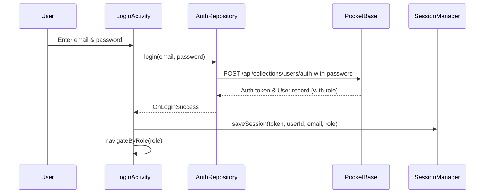

# Teledentistry Project - Application Flows & Architecture Documentation

This document provides a comprehensive overview of the application flows, architecture, Role-Based Access Control (RBAC), and feature navigation in the Teledentistry Android application.

---

## 1. Architecture & Core Components

The application is built using a modern Android architecture (Activities, Repositories, Retrofit/PocketBase integration, and `SessionManager`):

- **Backend / BaaS**: PocketBase REST API (`PocketBaseApi`, `PocketBaseClient`) handling authentication, database records, and media uploads.
- **Session Management (`SessionManager`)**: Secures local storage (`SharedPreferences`) for auth tokens, user IDs, email addresses, and roles (`patient`, `practitioner`, `admin`).
- **Repositories**: Encapsulate data access logic (`AuthRepository`, `PatientRepository`, `AppointmentRepository`, `BillingRepository`, `PractitionerRepository`, etc.).
- **UI Layer**: Modular Activities organized by user roles (`ui/auth`, `ui/patient`, `ui/dentist`, `ui/admin`, `ui/consultation`).

---

## 2. Authentication & Session Flow

### Flow Details:
1. **App Launch (`LoginActivity`)**:
   - Checks if an active session exists via `SessionManager.isLoggedIn()`.
   - If true, validates the existing token via `AuthRepository.validateSession()`. If valid, routes directly to the appropriate home portal. If expired, clears the session and prompts login.
2. **Login Attempt**:
   - Validates input format (email pattern and non-empty password).
   - Calls `AuthRepository.login()`. On success, stores session credentials in `SessionManager` and triggers RBAC routing.
3. **Logout Flow (All Portals)**:
   - Available via the Logout button in Patient Home, Dentist Home, and Admin Home.
   - Clears session data (`sessionManager.clearSession()`) and redirects to `LoginActivity` with intent flags (`FLAG_ACTIVITY_NEW_TASK | FLAG_ACTIVITY_CLEAR_TASK`) to prevent back-navigation to protected screens.

---

## 3. Role-Based Access Control (RBAC) & Portal Routing

Once authenticated, `navigateByRole(String role)` routes the user to their respective portal based on the PocketBase user role:

| Role | Target Activity | Description |
| :--- | :--- | :--- |
| `patient` | `PatientHomeActivity` | Patient Portal dashboard for booking appointments, viewing records, billing, prescriptions, etc. |
| `practitioner` | `DentistHomeActivity` | Practitioner Portal dashboard for managing appointments, patient records, treatment plans, availability, and video calls. |
| `admin` | `AdminHomeActivity` | System Administration dashboard for approving practitioner licenses, managing users, reviewing enquiries, and reports. |

---

## 4. Patient Portal Flows

From `PatientHomeActivity`, patients have access to the following integrated workflows:

1. **Profile Management (`PatientProfileActivity`)**: View and update patient profile details.
2. **Book Appointment (`BookAppointmentActivity`)**: Search for available dentists/practitioners and book appointment slots.
3. **Appointments (`PatientAppointmentsActivity`)**: View upcoming and past appointments with live status indicators.
4. **Dental Records (`PatientDentalRecordActivity`)**: View patient dental charts, tooth records, and diagnostic history.
5. **Chat (`ChatActivity`)**: Real-time messaging interface with assigned dentists.
6. **Upload Dental Image (`UploadImageActivity`)**: Upload clinical images/X-rays categorized by type (Tooth, Gum, Mouth, X-Ray).
7. **Treatment Plans (`PatientTreatmentPlanActivity`)**: View prescribed dental treatment plans and milestones.
8. **Prescriptions (`PatientPrescriptionsActivity`)**: Review issued prescriptions and medications.
9. **Billing (`PatientBillingActivity`)**: Inspect billing statements, insurance coverage, patient balance, and payment statuses.
10. **Insurance Claims (`PatientInsuranceClaimsActivity`)**: Submit and track insurance claims.
11. **Video Consultation (`VideoCallActivity`)**: Join secure telehealth video calls with practitioners.

---

## 5. Practitioner (Dentist) Portal Flows

From `DentistHomeActivity`, practitioners manage their clinical practice:

1. **Start Consultation (`VideoCallActivity`)**: Initiate telehealth video consultations with patients.
2. **Appointments (`PractitionerAppointmentsActivity`)**: View, accept, or update appointment schedules.
3. **Patient Records (`PatientRecordsActivity`)**: Access comprehensive patient dental files and clinical history.
4. **Uploaded Images (`UploadedImagesActivity`)**: Review diagnostic photos and X-rays submitted by patients.
5. **Treatment Management (`TreatmentManagementActivity`)**: Issue diagnoses, prescriptions, and treatment plans.
6. **Dentist Profile (`DentistProfileActivity`)**: Manage professional credentials and profile.
7. **Manage Availability (`PractitionerAvailabilityActivity`)**: Set available working hours and scheduling slots.

---

## 6. Admin Portal Flows

From `AdminHomeActivity`, administrators oversee platform operations:

1. **Practitioner Approvals (`PractitionerApprovalsActivity`)**: Review and verify practitioner license applications.
2. **Manage Users (`ManageUsersActivity`)**: Administer user accounts across roles.
3. **User Enquiries (`UserEnquiriesActivity`)**: Review support and user inquiries.
4. **Reports (`ReportsActivity`)**: Generate and export system reports and metrics.
